**Práctica 4	phpmyadmin**

1. Instalación phpmyadmin.

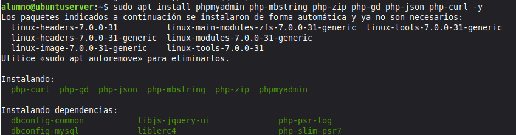  
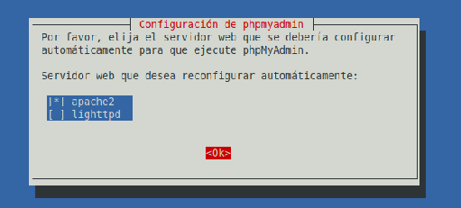  
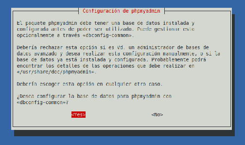  
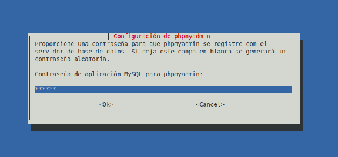  
alumno

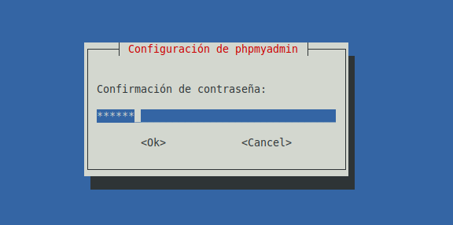  
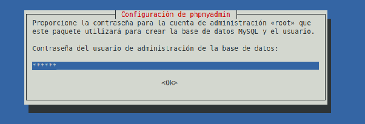

2. Configurar nginx.

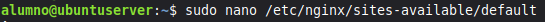  
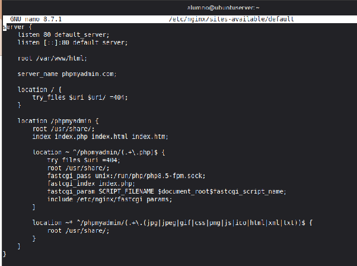  
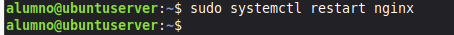

3. Comprobar versión php.

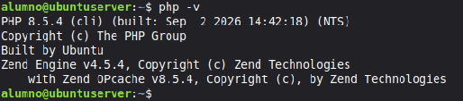

4. Comprobar las extensiones de php.

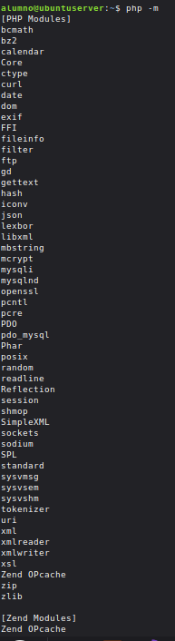

5. Comprobar si phpmyadmin está bien instalado.

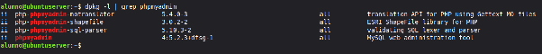

6. Comprobar ubicación de phpmyadmin. 

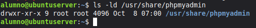

7. Comprobar que phpmyadmin abre desde el navegador de cliente.

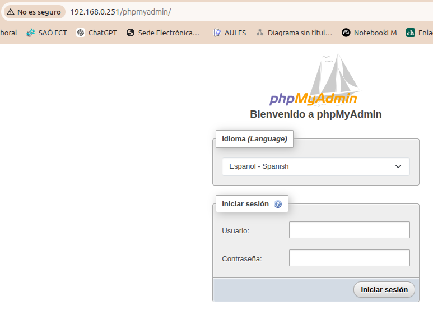

8. Comprobamos que podemos entrar en mariadb

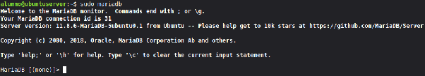

9. Comprobar los métodos de autentificación de los usuarios.

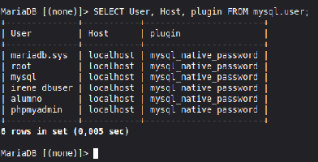

10. Modificar la contraseña de root.

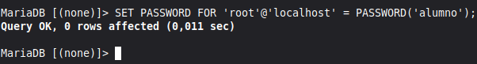

11. Comprobar que se ha guardado la contraseña de root.

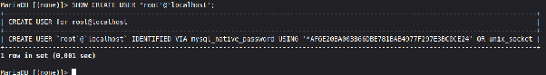

12. Iniciar configuración segura de mariadb

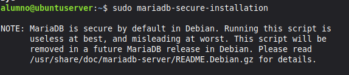

13. Comprobar que al entrar con el usuario root, pide contraseña y nos deja entrar correctamente. 

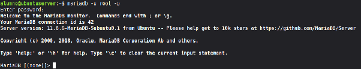

14. Comprobar acceso desde phpmyadmin desde el navegador con el usuario root.

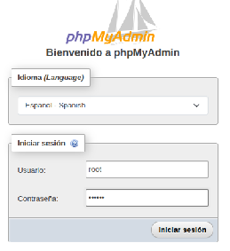  
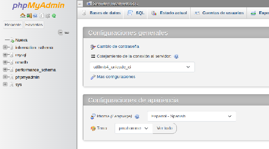

15. Crear un usuario para phpmyadmin.

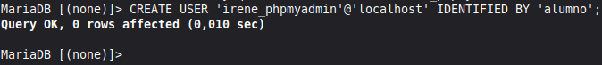

16. Asignar permisos a irene.

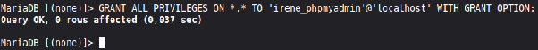

17. Verificar los permisos.

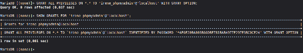

18. Comprobamos que podemos entrar vía web con en nuevo usuario.

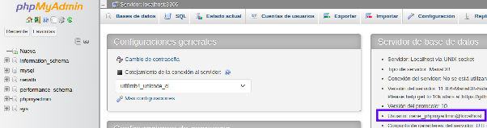

19. htpasswd.  
    1. Comprobar htpasswd.

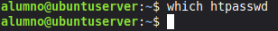  
No está instalado

2. Instalamos.

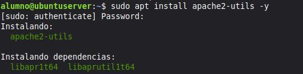

3. Volvemos a comprobar.

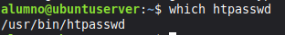

20. Crear archivo de contraseñas.

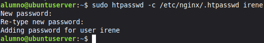

21. Preparar protección para phpmyadmin.  
    1. Antes de nada hacemos una copia de seguridad de la configuración.

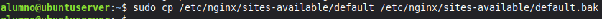

2. Editamos la configuración.

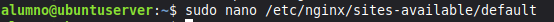  
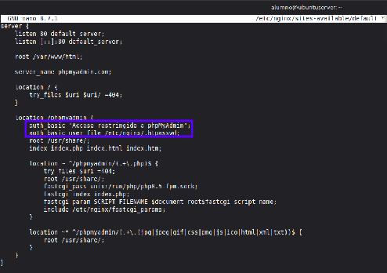

22. Comprobar configuración de nginx.

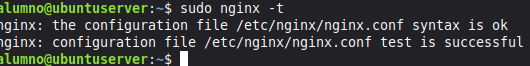

23. Aplicar cambios nginx.

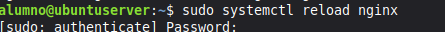

24. Comprobar la doble autenticación.

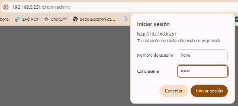  
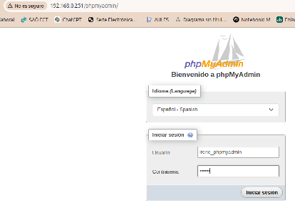

25. Automatización con bash.  
    1. Crear carpeta del proyecto.

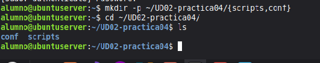

2. Crear .env

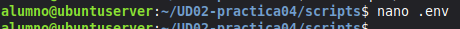  
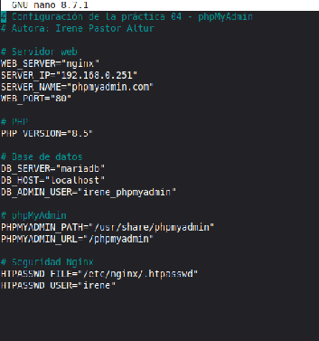

3. Crear .gitignore

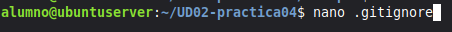  
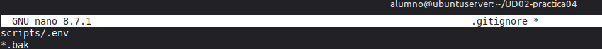  
Ignoramos el .env y las copias de seguridad \*.bak

4. Crear install\_lemp.sh

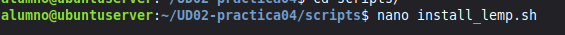  
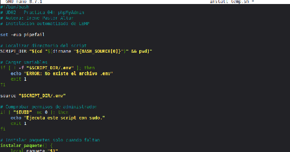

5. Comprobar que no tiene errores.

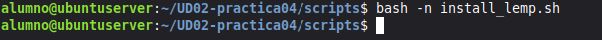

6. Dar permisos de ejecución.

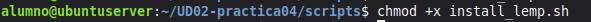

7. Crear install\_phpmyadmin.sh

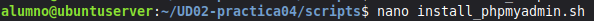

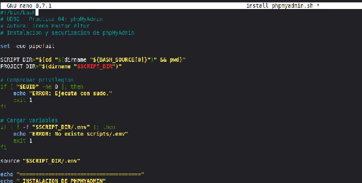

8. Comprobar sintaxis.

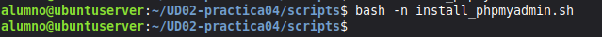

9. Dar permisos.

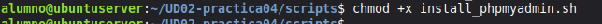

26. Guardar configuración nginx.

27. Guardar copia de .env sin las contraseñas.

28. Comprobar estructura del proyecto.

29. Crear repositorio Git.

30. Comprobamos Git y entramos dentro de la carpeta del proyecto.

31. Añadimos la copia del .env a .gitignore para no subirlo a git.

32. Inicializar repositorio.

33. Crear el user name.

34. Configurar el correo.

35. Ver archivos pendientes de subir a git.

36. Preparar los archivos git add .

37. Crear primer commit.

38. Conectar git con Github.

39. Comprobar dirección con git.

40. Asegurarnos que la rama principal es main.

41. Creo un nuevo token.

   

42. Git push.

43. Crear github pages.

44. Creamos un index.html 

  

45. Lo añadir al repositorio.

46. Hacemos un commit.

47. Subimos a github.

****

48. Comprobamos que ya vemos la página.  
      
    https\://ireneiremart.github.io/UD02-practica04-phpmyadmin/

